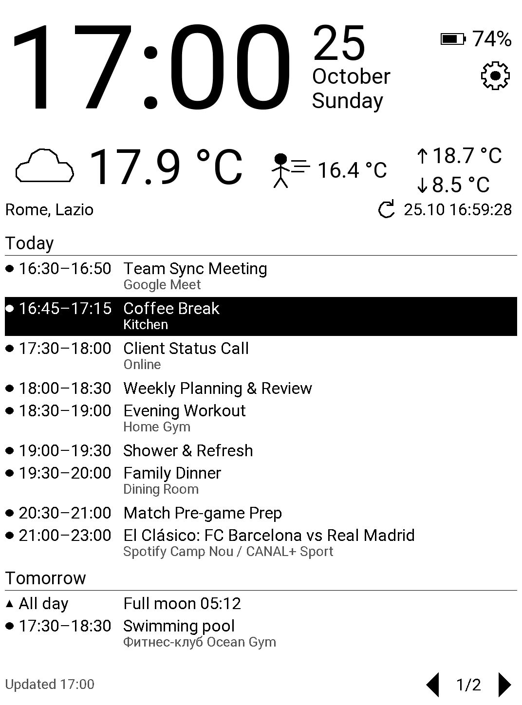
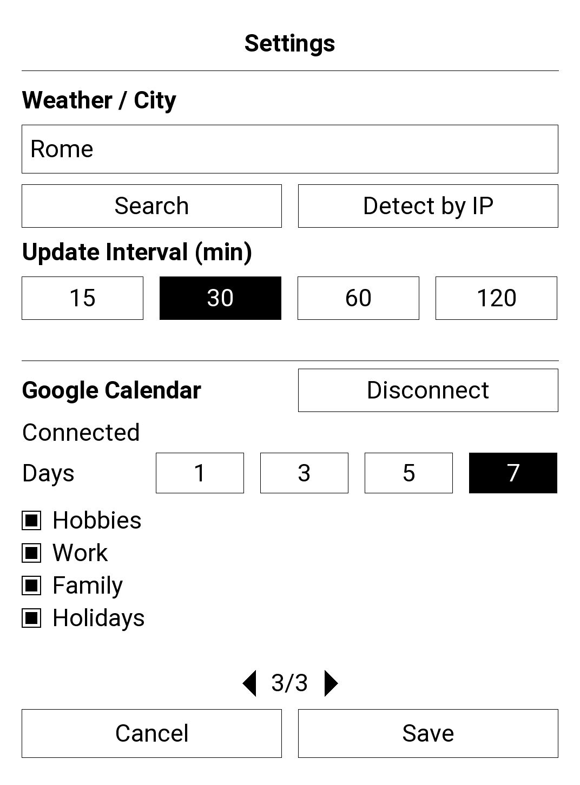

# InkDay


Website: [inkday.fandorka.eu](https://inkday.fandorka.eu/)

A native dashboard application for PocketBook Verse Pro e-reader, written in C on top of the
InkView SDK. InkDay turns the reader into an always-on information screen with a large
clock, date, battery level, current weather and upcoming Google Calendar events, drawn
with partial e-ink updates to keep power usage low.

> Status: early development, tested on a single PocketBook device (Verse Pro, 1072×1448 portrait
> screen). The layout is not yet adaptive to other screen sizes.

## Screenshots

| Dashboard | Settings |
|:---------:|:--------:|
|  |  |

## Features

- **Clock and date** — large clock updated once per minute, localized day and month names
  from the reader's system language.
- **Localized UI** — follows the reader's language: firmware translations where available,
  plus built-in strings for Russian, Belarusian, Ukrainian, Polish, German, French,
  Spanish, Italian, Dutch, Turkish and Chinese (Simplified); English otherwise.
- **Battery** — charge percentage with an icon.
- **Weather** from [Open-Meteo](https://open-meteo.com/) (no API key required):
  - current temperature and "feels like" temperature;
  - today's minimum and maximum;
  - day/night weather icons based on WMO weather codes;
  - selected city/region, last update time and a manual refresh button.
- **Weather cache** — the last successful result is restored at startup, so the screen is
  filled immediately, even without network. Cached data is used only for the same location
  and only if it was received today.
- **Automatic location on first run** — when no city is configured, InkDay detects an
  approximate location by IP address ([ipwho.is](https://ipwho.is/)) in the background and
  saves it. Settings are opened only if detection fails.
- **Google Calendar** (read-only):
  - events of the selected calendars for 1, 3, 5 or 7 days, grouped by day
    ("Today", "Tomorrow", "Tuesday, 27.10");
  - time range, title, location and a per-calendar marker shape;
  - the event in progress is highlighted (inverted row);
  - several pages with a page indicator: tap the left/right half of the list, swipe, or
    use the page-turn buttons;
  - cached on the device, so events are shown immediately after start and offline.
- **One refresh schedule** — weather and calendar are updated with the same interval;
  the refresh button under the weather updates both.
- **Settings screen** — city search with disambiguation by region/country, detection by
  IP, refresh interval of 15, 30, 60 or 120 minutes; Google account connection, number of
  days and calendar selection (paged list, also switchable by swipe).
- **Night mode** — follows the reader's inverted screen mode, including the system status
  panel.
- **Power-aware** — no per-second timers; one timer until the next request, network is
  brought up through the system network manager only when needed.

Tap the screen to show or hide the system status panel. Tap the gear icon to open settings.

### Connecting Google Calendar

1. Open settings and press **Connect** in the Google Calendar section.
2. The reader's browser opens Google sign-in. Allow read-only access to calendars.
3. The final page says "Done" and silently downloads `inkday-auth.txt` to `Downloads`.
   Return to InkDay: it picks up the file, deletes it and loads the calendar list.
4. Select calendars and the number of days, then press **Save**.

The reader cannot receive an OAuth redirect itself (its loopback interface is down for
applications), so sign-in goes through a static relay page,
[`docs/oauth.html`](docs/oauth.html), served by GitHub Pages. The page only forwards the
authorization code; it is useless without the PKCE verifier, which never leaves the
reader. Until the app passes Google verification, the consent screen shows
"Google hasn't verified this app": choose **Continue**. If Google revokes the access
(for example, it was removed in the Google Account), InkDay shows "Reconnect required".
See the [privacy policy](https://inkday.fandorka.eu/privacy.html).

## Requirements

### Device

- PocketBook e-reader with InkView firmware (developed on firmware with `libinkview`
  exposing `SetPanelInvert`; older firmware still works, but the panel stays light in
  night mode).
- `/usr/bin/curl` with HTTPS support on the device (present in current firmware).
- Wi-Fi configured on the reader.

### Build host

- Linux (developed under Ubuntu 24.04, including WSL) on x86_64.
- `clang` and `ld.lld` (tested with LLVM 18).
- [PocketBook SDK](https://github.com/blchinezu/pocketbook-sdk) (`SDK_481`), which provides the ARM sysroot, InkView headers and
  libraries, and a static `libjson-c.a`.

```bash
sudo apt install clang lld
```

## Building

The SDK is expected next to this repository:

```text
pocketbook/
├── pocketbook-sdk/SDK_481/
└── InkDay/          # this repository
```

From the repository directory:

Google OAuth client credentials are compiled in from a `.env` file in the repository
directory (never commit it):

```text
google_web_client_id=....apps.googleusercontent.com
google_web_client_secret=GOCSPX-...
```

The client must be of type *Web application* with the relay page as its authorized
redirect URI (`https://inkday.fandorka.eu/oauth.html`, set as `GOOGLE_RELAY_URL` in
`google_auth.c`); the same client ID is set in `docs/oauth.html`. A fork must host the
page on its own domain and change both. The project needs the Google Calendar API enabled, the
`calendar.readonly` scope, and its publishing status set to *In production*: in *Testing*
status Google issues refresh tokens that expire after 7 days (and only test users can
sign in). Publishing requires the branding pages described below.
The build stops with a clear message if the credentials are missing.

```bash
make            # build/InkDay.app
make clean
```

If the SDK is elsewhere, pass its path: `make SDK=/path/to/SDK_481`.
Objects and the binary go to `build/`. Header dependencies are tracked automatically.

The result is a 32-bit ARM EABI5 dynamic executable (`make` prints the `file` output).

json-c is linked **statically** because the SDK and the device ship different json-c
sonames.

## Debugging

Remote debugging uses the static `gdbserver` from the SDK on the reader and
`gdb-multiarch` on the PC (the SDK's gdb 7.4 cannot read Clang's DWARF 5):

```bash
sudo apt install gdb-multiarch
make gdbserver-install   # once: copies gdbserver to /mnt/ext1/system/bin/
make debug               # terminal 1: -g -O0 build in build/debug/, runs under gdbserver
make gdb                 # terminal 2: connects to the reader's IP on port 2345
```

In gdb, set breakpoints (`break weather_read_result`) and type `continue` to start the
app. Closing gdb or InkDay ends the session. Run `make deploy` afterwards to put the
release build back on the reader.

## Installation

Download the ready-built
[`InkDay.zip`](https://github.com/Kif-Fando/InkDay/releases/latest/download/InkDay.zip)
from the [latest release](https://github.com/Kif-Fando/InkDay/releases/latest) and unzip
it, or build it yourself (see above). Copy `InkDay.app` to the `applications` folder on the reader's internal storage
(`/mnt/ext1/applications/` on the device), then start it from the Applications menu.

Over USB, the folder is `applications/` in the root of the reader's storage.

### Publishing a release

```bash
make release VERSION=1.0
```

This refuses to run with uncommitted changes, makes a clean release build and creates the
GitHub release `v1.0` with `build/InkDay.zip` attached (GitHub does not accept `.app`
files; needs the [GitHub CLI](https://cli.github.com/) logged in, and the commit pushed).
The website links to `releases/latest/download/InkDay.zip`, so keep the asset name.

### Deploying over SSH (development)

With an SSH server running on the reader (for example Dropbear) and a host alias `pb`
in `~/.ssh/config`:

```bash
make deploy                 # or: make deploy PB_HOST=myreader
```

This builds the app, stops a running copy, uploads it with `scp -O` and starts it
in the SSH session.

The legacy SCP protocol (`scp -O`), which Dropbear requires, is used. Diagnostic messages are
written to stderr and are visible in the SSH session.

### Menu icon

Without extra setup the reader lists InkDay with a generic icon. To give it its own:

```bash
make install-icon
```

then restart the reader. This copies `icons/InkDay.bmp` and `icons/InkDay_f.bmp`
(pressed state) to `applications/icons/` and adds a `U_InkDay` entry to the "General"
group of `system/config/desktop/view.json`. The original file is saved as
`view.json.inkday-backup` next to it; copy it back to undo. The desktop format is
firmware-specific (documented in the comments of `view.json` itself) and was tested on
one device only. Over USB, the same can be done by hand: copy the two BMP files and
merge the entry printed by `tools/desktop-entry.py` into `view.json`.

## Files on the device

| Path | Purpose |
|------|---------|
| `/mnt/ext1/applications/InkDay.app` | Application |
| `/mnt/ext1/system/config/inkday.json` | Settings: city, coordinates, refresh interval |
| `/mnt/ext1/system/config/inkday-weather.json` | Last successful weather result |
| `/mnt/ext1/system/config/inkday-calendar.json` | Calendar settings: days, selected calendars |
| `/mnt/ext1/system/config/inkday-calendar-cache.json` | Calendar list and events of the last sync |
| `/mnt/ext1/system/config/inkday-google.json` | Google refresh token (mode 0600) |
| `/mnt/ext1/system/config/inkday-google-signin.txt` | Pending sign-in (PKCE verifier), removed when done |

All files are written atomically (temporary file + `rename`). Delete `inkday.json` to
repeat first-run location detection; delete `inkday-weather.json` to clear the weather
cache. **Disconnect** in settings deletes the Google token and the calendar cache.

## Source layout

| File | Responsibility |
|------|----------------|
| `main.c` | Application lifecycle, theme, clock/date/battery, screen navigation, first-run location detection |
| `weather.c/.h` | Weather requests via `curl`, response validation, cache, drawing, manual refresh |
| `settings.c/.h` | Settings screen: keyboard input, city search, IP detection, refresh interval |
| `geocoding.c/.h` | Asynchronous city search (Open-Meteo) and IP location (ipwho.is) |
| `settings_store.c/.h` | Validated loading and atomic saving of settings |
| `calendar.c/.h` | Google Calendar: sync state machine, cache, settings, drawing and paging |
| `google_auth.c/.h` | OAuth 2.0 with PKCE through the relay page, token storage and refresh |
| `http_job.c/.h` | Generic asynchronous HTTPS request via `curl` (secrets passed in a temporary config file, not argv) |
| `sha256.c/.h` | SHA-256 for the PKCE code challenge |
| `file_util.c/.h` | Atomic file writes and bounded file reads |
| `i18n.c/.h` | User-visible strings: firmware translations, built-in dictionaries, English fallback |
| `docs/` | GitHub Pages site: home page, privacy policy, terms, sign-in relay `oauth.html`, images |
| `tools/make-icon.py` | Draws the icon: website/Google logo in `docs/images/` and menu icons in `icons/`; needs Pillow |
| `tools/desktop-entry.py` | Adds InkDay to a copy of the reader's `view.json` (used by `make install-icon`) |
| `icons/` | Menu icons for the reader (8-bit grayscale BMP, 100×100, line art like the firmware icons) |
| `CONTINUE.md` | Development notes and plan (in Russian) |

Network requests run `curl` in a child process and are polled by a timer, so the UI never
blocks.

## Website and Google branding

The `docs/` folder is published by GitHub Pages (branch `master`, folder `/docs`) under the
custom domain `inkday.fandorka.eu` (`docs/CNAME`; the domain is verified in Google
Search Console, which branding verification requires) and
provides what the Google Auth Platform *Branding* page asks for:

| Field | Value |
|-------|-------|
| App logo | `docs/images/icon-120.png` (120×120) |
| Application home page | `https://inkday.fandorka.eu/` |
| Privacy policy | `https://inkday.fandorka.eu/privacy.html` |
| Terms of service | `https://inkday.fandorka.eu/terms.html` |
| Authorized domain | `fandorka.eu` |

Screenshots live in `docs/images/` and are shared by the website and this README.

## Roadmap

- Home Assistant integration.

## Third-party services

- Weather data: [Open-Meteo](https://open-meteo.com/) — see its
  [terms](https://open-meteo.com/en/terms) and attribution requirements.
- City search: Open-Meteo Geocoding API.
- IP-based location: [ipwho.is](https://ipwho.is/). The reader's public IP address is
  sent to this service on first run or when "Detect by IP" is used.
- Calendar: [Google Calendar API](https://developers.google.com/calendar), read-only
  access granted by the user.

## License

Not yet chosen.
