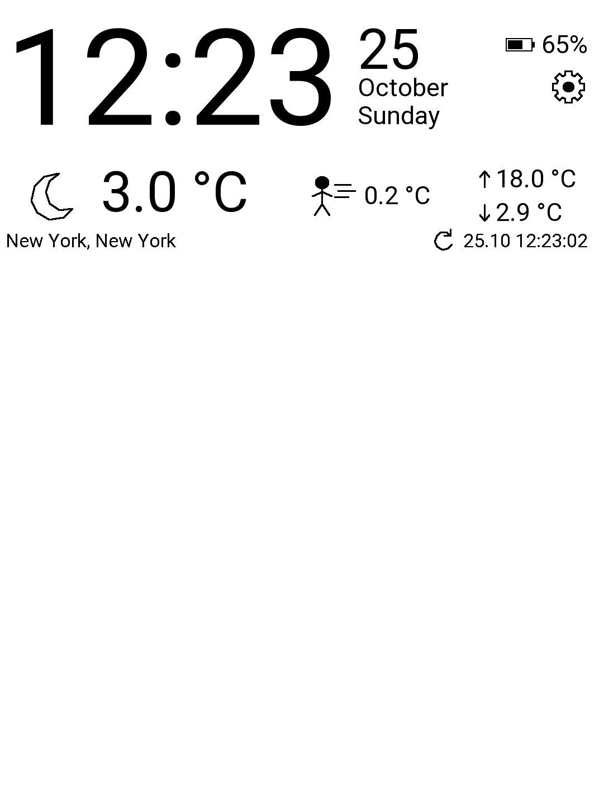
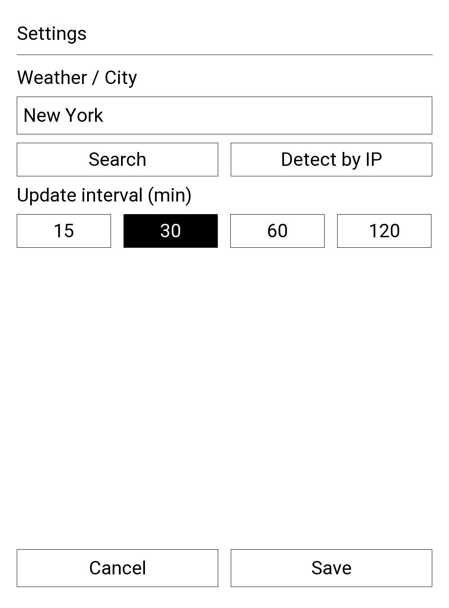

# InkDay

A native dashboard application for PocketBook e-readers, written in C on top of the
InkView SDK. InkDay turns the reader into an always-on information screen with a large
clock, date, battery level and current weather, drawn with partial e-ink updates to keep
power usage low.

> Status: early development, tested on a single PocketBook device (1072×1448 portrait
> screen). The layout is not yet adaptive to other screen sizes.

## Screenshots

| Dashboard | Settings |
|:---------:|:--------:|
|  |  |

## Features

- **Clock and date** — large clock updated once per minute, localized day and month names
  from the reader's system language.
- **Localized UI** — follows the reader's language: firmware translations where available,
  plus built-in strings for Russian, Belarusian, Ukrainian, Polish, German, French,
  Spanish, Italian, Dutch, Turkish and Chinese (Simplified); English otherwise.
- **Battery** — charge percentage with an icon.
- **Weather** from [Open-Meteo](https://open-meteo.com/) (no API key required):
  - current temperature and "feels like" temperature;
  - today's minimum and maximum;
  - day/night weather icons based on WMO weather codes;
  - selected city/region, last update time and a manual refresh button.
- **Weather cache** — the last successful result is restored at startup, so the screen is
  filled immediately, even without network. Cached data is used only for the same location
  and only if it was received today.
- **Automatic location on first run** — when no city is configured, InkDay detects an
  approximate location by IP address ([ipwho.is](https://ipwho.is/)) in the background and
  saves it. Settings are opened only if detection fails.
- **Settings screen** — city search with disambiguation by region/country, detection by
  IP, refresh interval of 15, 30, 60 or 120 minutes.
- **Night mode** — follows the reader's inverted screen mode, including the system status
  panel.
- **Power-aware** — no per-second timers; one timer until the next request, network is
  brought up through the system network manager only when needed.

Tap the screen to show or hide the system status panel. Tap the gear icon to open settings.

## Requirements

### Device

- PocketBook e-reader with InkView firmware (developed on firmware with `libinkview`
  exposing `SetPanelInvert`; older firmware still works, but the panel stays light in
  night mode).
- `/usr/bin/curl` with HTTPS support on the device (present in current firmware).
- Wi-Fi configured on the reader.

### Build host

- Linux (developed under Ubuntu 24.04, including WSL) on x86_64.
- `clang` and `ld.lld` (tested with LLVM 18).
- [PocketBook SDK](https://github.com/blchinezu/pocketbook-sdk) (`SDK_481`), which provides the ARM sysroot, InkView headers and
  libraries, and a static `libjson-c.a`.

```bash
sudo apt install clang lld
```

## Building

The SDK is expected next to this repository:

```text
pocketbook/
├── pocketbook-sdk/SDK_481/
└── InkDay/          # this repository
```

From the repository directory:

```bash
make            # build/InkDay.app
make clean
```

If the SDK is elsewhere, pass its path: `make SDK=/path/to/SDK_481`.
Objects and the binary go to `build/`. Header dependencies are tracked automatically.

The result is a 32-bit ARM EABI5 dynamic executable (`make` prints the `file` output).

json-c is linked **statically** because the SDK and the device ship different json-c
sonames.

## Installation

Copy `InkDay.app` to the `applications` folder on the reader's internal storage
(`/mnt/ext1/applications/` on the device), then start it from the Applications menu.

Over USB, the folder is `applications/` in the root of the reader's storage.

### Deploying over SSH (development)

With an SSH server running on the reader (for example Dropbear) and a host alias `pb`
in `~/.ssh/config`:

```bash
make deploy                 # or: make deploy PB_HOST=myreader
```

This builds the app, stops a running copy, uploads it with `scp -O` and starts it
in the SSH session.

The legacy SCP protocol (`scp -O`), which Dropbear requires, is used. Diagnostic messages are
written to stderr and are visible in the SSH session.

## Files on the device

| Path | Purpose |
|------|---------|
| `/mnt/ext1/applications/InkDay.app` | Application |
| `/mnt/ext1/system/config/inkday.json` | Settings: city, coordinates, refresh interval |
| `/mnt/ext1/system/config/inkday-weather.json` | Last successful weather result |

Both JSON files are written atomically (temporary file + `rename`). Delete
`inkday.json` to repeat first-run location detection; delete `inkday-weather.json` to
clear the weather cache.

## Source layout

| File | Responsibility |
|------|----------------|
| `main.c` | Application lifecycle, theme, clock/date/battery, screen navigation, first-run location detection |
| `weather.c/.h` | Weather requests via `curl`, response validation, cache, drawing, manual refresh |
| `settings.c/.h` | Settings screen: keyboard input, city search, IP detection, refresh interval |
| `geocoding.c/.h` | Asynchronous city search (Open-Meteo) and IP location (ipwho.is) |
| `settings_store.c/.h` | Validated loading and atomic saving of settings |
| `i18n.c/.h` | User-visible strings: firmware translations, built-in dictionaries, English fallback |
| `CONTINUE.md` | Development notes and plan (in Russian) |

Network requests run `curl` in a child process and are polled by a timer, so the UI never
blocks.

## Roadmap

- Own translations for labels the firmware does not provide.
- Remote debugging with GDB.
- Google Calendar widget.
- Custom application name and icon in the reader's menu.
- Home Assistant integration.

## Third-party services

- Weather data: [Open-Meteo](https://open-meteo.com/) — see its
  [terms](https://open-meteo.com/en/terms) and attribution requirements.
- City search: Open-Meteo Geocoding API.
- IP-based location: [ipwho.is](https://ipwho.is/). The reader's public IP address is
  sent to this service on first run or when "Detect by IP" is used.

## License

Not yet chosen.
